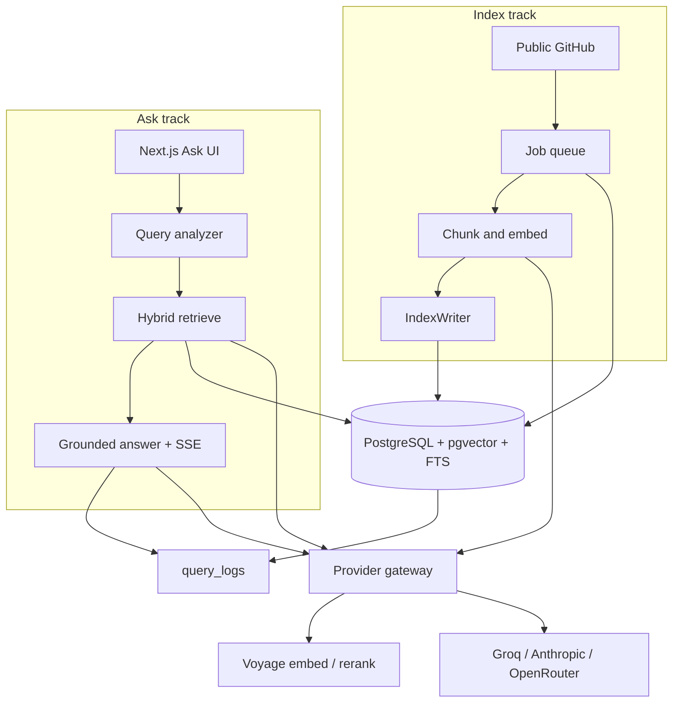

<div align="center">

# ◈ Repo Cartographer

**Ask your codebase. Verify every answer.**

Cited, commit-pinned answers from public GitHub repositories, with a trace that shows how each answer was built.

[Live demo](https://repo-cartographer.vercel.app/) · [API contract](API.md) · [Security](SECURITY.md) · [Contributing](CONTRIBUTING.md)

[](https://github.com/RAHULDINDIGALA-32/repo-cartographer/actions/workflows/ci.yml)
[](LICENSE)
[](backend/pyproject.toml)
[](frontend/package.json)

</div>

---

## Overview

Repo Cartographer is a production-shaped RAG system for **public GitHub repositories**. An operator indexes a default-branch snapshot; anyone can then ask questions and receive grounded answers with `file:line` citations that open on the exact indexed commit.

The product is two tracks sharing one store:

- **Index track** — shallow clone, AST-aware chunking, Voyage embeddings, incremental sync, Postgres-backed jobs.
- **Ask track** — query analysis, dense/sparse/symbol retrieval, grounded generation over SSE, structural citation checks, and an inspectable trace.

History stays on the user’s device. Repository source is never executed. Answers refuse when evidence is missing.

**Live:** [https://repo-cartographer.vercel.app/](https://repo-cartographer.vercel.app/)  
**Source:** [RAHULDINDIGALA-32/repo-cartographer](https://github.com/RAHULDINDIGALA-32/repo-cartographer)

## Features

| Area | What ships |
| --- | --- |
| Grounded Q&A | Streaming SSE answers, numbered citations, commit-pinned GitHub permalinks, visible index freshness |
| Hybrid retrieval | Dense (pgvector), identifier-aware sparse/FTS, BM25, symbol signals, weighted RRF, optional Voyage rerank |
| Indexing | Tree-sitter AST chunks, deterministic embedding headers, cross-repo vector reuse by content hash |
| Freshness | Incremental sync of changed files, coalesced job queue, scheduler, optional signed GitHub webhooks |
| Explainability | Retrieval inspector, query traces, source viewer, admin stats and job history |
| Guardrails | Prompt-injection delimiters, public-URL canonicalization, rate/concurrency/token budgets, fail-closed admin auth |
| Frontend | Next.js ask workspace, landing replay, command palette, on-device IndexedDB history, admin console |

## Architecture

One PostgreSQL database. Two tracks. A provider gateway in between.



### Index track

1. **Public GitHub** — Canonical HTTPS URLs only. Depth-1, default-branch clone. Files are hashed and scanned; they are never executed.
2. **Job queue** — Postgres row locks, per-repo coalescing, heartbeats, retries with backoff, and a reaper for abandoned work. At most one running job per repository.
3. **Chunk & embed** — AST chunker (Python, TypeScript/JSX, JavaScript/JSX, Solidity, Markdown, config, generic fallback), identifier-split search text, Voyage `voyage-code-3` (1024-d) with reuse when `content_hash` + `embedder_version` match.
4. **IndexWriter** — Atomic per-file writes (chunks, then files). `indexed_sha` advances only after a successful run.

### Ask track

1. **Ask UI** — Direct browser → FastAPI. Tokens stream over SSE. Conversation history is IndexedDB-local (never sent back).
2. **Query analyzer** — Optional rule or LLM rewrite, identifier extraction, and path hints.
3. **Retrieve** — Dense + sparse + BM25 + symbols, fused with RRF, optional rerank and score priors, then a token-budgeted assembler.
4. **Generate** — Context blocks are delimited as untrusted data. The model must cite existing block numbers or refuse. Citations are structurally validated; snippets open as commit-pinned GitHub links.

### Shared spine

| Component | Role |
| --- | --- |
| PostgreSQL | `repos`, `files`, `chunks` (pgvector + FTS), `jobs`, `query_logs`, remote-head observations |
| Provider gateway | Voyage and LLM adapters with retries, timeouts, concurrency, and usage stats. Secrets never land in pipeline snapshots |
| Config | `config.yaml` owns chunker/retriever/generator *specs*. `.env` owns keys, limits, and host policy |

## Tech stack

| Layer | Choice |
| --- | --- |
| Frontend | Next.js 15 (App Router), React 19, TypeScript, Tailwind CSS 4, TanStack Query, Zod |
| Backend | Python 3.12, FastAPI, Uvicorn, Typer CLI, Pydantic Settings, structlog |
| Data | PostgreSQL 16 + pgvector, psycopg 3 |
| Ingestion | git, tree-sitter, tiktoken (`cl100k_base`) |
| Embeddings / rerank | Voyage AI (`voyage-code-3`, optional `rerank-2.5`) |
| Generation | Groq (default), Anthropic, OpenRouter, or a custom OpenAI-compatible endpoint |
| Jobs | In-process polling worker + scheduler (`API_RUN_WORKER`) |
| Hosting | Frontend on [Vercel](https://vercel.com); API as a Docker image on [Render](https://render.com); Database on hosted [Supabase](https://supabase.com) Postgres/pg-vector |
| Tooling | uv, Ruff, pytest, ESLint, Prettier, Vitest, GitHub Actions |

## Repository layout

```text
repo-cartographer/
├── backend/                 FastAPI app, CLI, migrations, tests
│   ├── app/                 ingestion, retrieval, generation, jobs, API
│   ├── migrations/
│   └── tests/
├── frontend/                Next.js App Router
│   └── src/app/             /  /app  /r/[repoId]  /admin
├── config.yaml              Pipeline spec (chunker, embedder, generator)
├── config/examples.yaml     Per-repo example questions
├── eval/                    Gold questions and retrieval presets
├── docs/                    API, deploy, security, operations, OpenAPI snapshot
├── docker-compose.yml       Local pgvector Postgres on :55432
└── Dockerfile               Non-root API image (git + CA certs)
```

**Frontend routes**

| Path | Purpose |
| --- | --- |
| `/` | Public landing (architecture, measured results, scripted answer replay) |
| `/app` | Ask workspace |
| `/r/<repoId>` | Deep link into a repository (question prefill via `?q=`, never auto-submit) |
| `/admin` | Operator console (API key in memory / optional `sessionStorage`) |

## How it works

### 1. Register and index

An administrator registers a public GitHub URL. The worker shallow-clones the default branch, filters files (symlinks, vendor, binaries, lockfiles, oversized/minified content), chunks with tree-sitter when a grammar is available, enriches a deterministic header, and embeds.

```text
path: src/example.py
language: Python
symbol: Parser.parse (method, part 1/2)
lines: 40-66

<exact source slice>
```

`content_hash` is SHA-256 over that header-plus-source text. Matching hashes reuse vectors across repositories and syncs.

### 2. Ask

`POST /v1/repos/{id}/ask` with `{ "question": "...", "stream": true }`. Events: `retrieval` → `status` → `token`* → `citations` → `done` | `error`. Disconnects cancel the stream and release the concurrency slot. Clients must not auto-retry POSTs (token spend).

### 3. Stay fresh

`index sync` compares the filtered scan to indexed file rows. Hash changes, new/deleted files, language changes, zero-chunk repairs, and chunker/embedder drift are reprocessed; unchanged hashes skip the provider. Writes are atomic per file. Pinned evaluation repos refuse automatic sync unless `--allow-pinned` is set.

Lazy ask-path staleness checks are TTL-bounded (`staleness_wait_ms`); a timeout does **not** block the answer. Optional `POST /v1/webhooks/github` verifies HMAC-SHA256 over the raw body and enqueues default-branch pushes for registered repos.

## HTTP API

Versioned under `/v1`. Full contract: [`API.md`](docs/api.md) and [`openapi.json`](openapi.json).

| Method | Path | Auth | Purpose |
| --- | --- | --- | --- |
| `GET` | `/health` | public | Liveness (no database) |
| `GET` | `/ready` | public | Postgres, migrations, vector dim, worker |
| `GET` | `/v1/repos` | public | Indexed repositories |
| `POST` | `/v1/repos/{id}/ask` | rate limited | Grounded answer (JSON or SSE) |
| `POST` | `/v1/feedback` | rate limited | Thumbs rating |
| `POST` | `/v1/repos` | admin | Register (+ optional enqueue) |
| `DELETE` | `/v1/repos/{id}` | admin | Remove repo and clone |
| `POST` | `/v1/repos/{id}/sync` | admin | Enqueue sync / full reindex |
| `GET` | `/v1/repos/{id}/jobs` | admin | Job history |
| `GET` | `/v1/queries/{id}` | admin | Query log + RAG trace |
| `GET` | `/v1/admin/stats` | admin | Operational aggregates |
| `GET` | `/v1/admin/queries` | admin | Query explorer |
| `POST` | `/v1/webhooks/github` | HMAC | Push freshness trigger |
| `GET` | `/metrics` | admin | Prometheus text |

Admin credentials: `X-API-Key` or `Authorization: Bearer <key>`, compared in constant time, never logged. Production CORS is an exact origin list (no `*`).

## Getting started

### Prerequisites

- Python 3.12 and [uv](https://docs.astral.sh/uv/)
- Node.js 20.11+
- Docker (for local PostgreSQL)
- Provider keys: `VOYAGE_API_KEY` for index/retrieve; a generator key matching `config.yaml` (`GROQ_API_KEY` by default)

### Database and backend

```bash
cp backend/.env.example backend/.env   # then set keys; for host CLI use localhost in DATABASE_URL
make start-db
cd backend
uv sync
uv run cartographer db migrate
uv run cartographer doctor
uv run cartographer-api                # http://127.0.0.1:8000
```

Local Postgres is `pgvector/pgvector:pg16` on port **55432**. The test database `cartographer_test` is created alongside it.

Index a public repository (CLI) or use `/admin` once the API is up:

```bash
uv run cartographer repo add https://github.com/pallets/flask
uv run cartographer repo fetch 1
uv run cartographer index plan 1
uv run cartographer index run 1
uv run cartographer ask 1 "Where does Flask dispatch a request?"
```

Useful operations: `index sync`, `index verify`, `jobs list`, `worker run --once`, `scheduler tick`, `queries prune`, `provider ping`. See [`OPERATIONS.md`](OPERATIONS.md).

### Frontend

```bash
cd frontend
cp .env.example .env.local
# NEXT_PUBLIC_API_BASE_URL=http://localhost:8000
npm install
npm run dev                            # http://localhost:3000
```

The browser talks to FastAPI directly. **Never** put admin or provider keys in `NEXT_PUBLIC_*`.

### Docker API image

```bash
docker build -t repo-cartographer .
# migrate against the target database first
docker run --env-file .env -p 8000:8000 repo-cartographer
```

The image runs as a non-root user, includes `git`, and excludes `.env`. The container filesystem is ephemeral: clones are re-fetched; indexed rows live in Postgres.
## Configuration

**Pipeline** (`config.yaml`): chunker, token budgets, embedder model/dimension, retriever (`dense` default; hybrid presets in `eval/presets.yaml`), RRF, reranker, generator spec (`provider`, `model`, `temperature`, `max_tokens`).

**Runtime** (`backend/.env`): database, CORS, admin keys, rate/concurrency/token budgets, worker flag, provider endpoints. Changing the embedding model or dimension is a re-index: it changes `embedder_version` and vector width.

Caps that keep a demo host honest include `MAX_REPOS`, `MAX_REPO_FILES`, `MAX_CHUNKS_PER_REPO`, `ASK_DAILY_TOKEN_BUDGET`, and `ASK_DAILY_PER_CLIENT`.

## Evaluation

Hand-verified gold evidence lives in [`eval/questions.yaml`](eval/questions.yaml) (pinned Flask and a less-famous NFT repo to reduce analyzer leakage). Presets live in [`eval/presets.yaml`](eval/presets.yaml).

```bash
uv run cartographer eval validate --path ../eval/questions.yaml
uv run cartographer eval retrieval <repo_id> --split tune --preset hybrid3 --path ../eval/questions.yaml
uv run cartographer ask <repo_id> "..." --preset hybrid3_rule --no-generate --trace
```

Retrieval metrics are not generation-quality or semantic-faithfulness scores. The gold set is small; dense retrieval outperformed measured hybrid presets on the Flask set — that is a recorded result, not a general claim.

**Recorded demo measurements** (not production SLOs):

| Measurement | Value |
| --- | --- |
| Embedding tokens for a one-file scratch sync | 55 |
| Embedding tokens for that repo’s full index | 4,268 |
| Chunks from a pinned 218-file Flask snapshot | 1,387 |
| Answerable Flask questions with the right file in dense top-5 | 21 / 22 |

## Security and privacy

Details: [`SECURITY.md`](SECURITY.md).

- Public GitHub HTTPS only; URLs are canonicalized. No private-repo OAuth in this scope.
- Source is treated as **untrusted prompt data** inside delimiters; injection-style instructions in code are ignored by policy.
- Citation checks are **structural** (valid block markers), not a proof that a citation semantically supports a claim.
- Admin keys, provider keys, database URLs, and webhook secrets belong in the host secret manager.
- Questions, answers, retrieval IDs, timings, and hashed client identities are stored for rate limits and feedback; query logs retain **90 days** by default (`cartographer queries prune`).
- Chat history in the browser is local (IndexedDB, versioned, optional). Share links only prefill `?q=`.
- Webhooks: HMAC-SHA256 over the raw body, delivery-ID dedupe, default-branch pushes only.
- HTTP hardening: `X-Content-Type-Options`, `X-Frame-Options`, `Referrer-Policy`, request IDs, body-size cap.

Questions and chunks are sent to the configured embedding and generation providers. Use public repositories only.

## Observability

- Structured logs with request IDs.
- `/metrics` (admin) — bounded Prometheus labels for HTTP, ask, provider, and jobs.
- `/v1/admin/stats` and `/v1/admin/queries` — operator exploration without dumping chunk text.
- `/ready` reports worker enablement and heartbeat age.

Rate limiting and in-process workers are **process-local**. Multi-instance production needs a shared limiter and a dedicated worker fleet.

## Testing and CI

GitHub Actions [`.github/workflows/ci.yml`](.github/workflows/ci.yml):

- Backend: `uv sync --frozen`, Ruff, pytest against pgvector, gold-set validate, Docker image build.
- Frontend: `npm ci`, typecheck, lint, Prettier, Vitest, production build.

```bash
make lint && make test
cd frontend && npm run typecheck && npm run lint && npm run format:check && npm test && npm run build
```

## Status and limitations

Shipped as a complete demo of the architecture above. Intentionally out of scope:

- Private repositories, user accounts, and OAuth
- Full git history (default-branch shallow snapshot only)
- Distributed workers, shared rate limiting, mid-run job cancellation
- Semantic citation faithfulness (structural checks only)
- Server-side or multi-device conversation sync

Free-tier hosts sleep; the UI surfaces a wake state. Clones vanish on container restart and are re-fetched safely.

## Contributing

See [CONTRIBUTING.md](CONTRIBUTING.md) for setup, code style, tests, and pull-request expectations.

## License

[MIT](LICENSE) © 2026 RAHUL DINDIGALA

## Acknowledgments

- [pgvector](https://github.com/pgvector/pgvector) for in-database embeddings
- [Voyage AI](https://www.voyageai.com/) code embeddings
- [tree-sitter](https://tree-sitter.github.io/tree-sitter/) grammars via `tree-sitter-language-pack`
- Evaluation work uses a pinned [Flask](https://github.com/pallets/flask) snapshot plus a second, less-famous repository to keep retrieval honest
